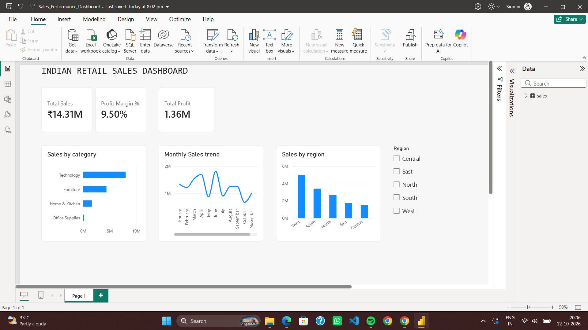

# Indian Retail Sales Dashboard | Power BI

## Project Overview

This project analyzes Indian retail sales data using Microsoft Power BI to understand sales performance, profitability, product categories, and regional trends.
The interactive dashboard helps users explore key business metrics and identify patterns that can support data-driven decision-making.

## Project Objectives

- Analyze total sales and total profit.
- Calculate and monitor profit margin.
- Compare sales performance across product categories.
- Track monthly sales trends.
- Compare sales across different regions.
- Enable interactive filtering by region.

## Dashboard Preview

## Key Performance Indicators (KPIs)

- Total Sales: ₹14.31M
- Total Profit: ₹1.36M
- Profit Margin: 9.50%

## Key Insights

- Technology is the leading sales category in the dashboard.
- The West region has the highest sales among the displayed regions.
- The dashboard provides a monthly view of sales performance.
- Regional filtering allows users to explore performance across different parts of India.

*Note: These observations are based on the current dashboard and may change when filters are applied.*

## Tools & Technologies

- Microsoft Power BI Desktop
- Power Query for data preparation
- DAX for measures and calculations
- CSV for the dataset
- GitHub for project documentation and version control

## Project Files

| File | Description |
| `indian_retail_sales_powerbi.csv` | Retail sales dataset |
| `Sales_Performance_Dashboard.pbix` | Power BI dashboard file |
| `Dashboard.png` | Dashboard screenshot |
| `README.md` | Project documentation |

## How to Use

1. Download or clone this repository.
2. Open `Sales_Performance_Dashboard.pbix` in Power BI Desktop.
3. If prompted, update the CSV data source path to the location of `indian_retail_sales_powerbi.csv`.
4. Refresh the data if required.
5. Explore the dashboard using the available filters and visualizations.

## Author
Samiksha

Aspiring Data Analyst | Power BI | SQL | Data Visualization

---

⭐ If you find this project useful, consider giving the repository a star.
